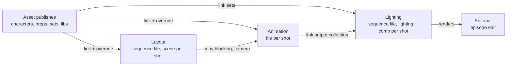

# blender-smallstudio-pipeline

Publishing, loading and scene construction for one person or a small team, entirely
inside Blender. Built for an animated comic series, with nothing studio-specific baked in.

> **Status: early.** The design is settled and the Blender behaviour it depends on has been
> tested (see [spikes](spikes/RESULTS.md)). The tool itself is being built milestone by
> milestone; nothing is usable in production yet.

## What it does

- **Publishing.** Checks run first ([publish-validator](https://github.com/jmleventhorpe/publish-validator)),
  then only the asset's root collection and its dependencies are written: a versioned file
  plus a hero file that shots link, so they pick up the latest on open.
- **Loading.** Assets come in through Blender's Asset Browser, linked by default, with
  library overrides only where something must be editable.
- **Shots.** Layout creates shots from sequencer strips and decides casting. Animation
  files are built from layout, lighting files from the animation publishes, and the
  episode edit from the best media available.
- **No database.** Each entity is a folder with a small metadata file; per-project
  settings live in a `pipeline.toml` at the project root.

Blender 5.2 LTS only. Kitsu support is planned behind a tracker interface.

## How it fits together



## Layout of the code

| Path | What's there |
| --- | --- |
| `src/smallstudio_pipeline/core/` | Pipeline logic with no Blender imports: config, paths, entities, versioning. Tested in plain Python. |
| `src/smallstudio_pipeline/blender/` | The thin Blender layer: operators, menus, panels. Tested in headless Blender. |
| `tests/core/`, `tests/blender/` | The two test suites. |
| `spikes/` | Scripts that tested the Blender behaviour the design relies on, with [results](spikes/RESULTS.md). |
| `scripts/build_extension.py` | Builds and validates the extension zip. |

## Development

Needs [uv](https://docs.astral.sh/uv/) and Blender 5.2 on the `PATH` (or in `$BLENDER`).

```bash
uv sync
```

```bash
uv run pytest
```

```bash
uv run ruff check && uv run ruff format --check && uv run pyright
```

Tests inside Blender use a pytest installed next to the repo, since Blender doesn't bundle it:

```bash
uv pip install --python 3.13 --target .blender-site pytest
```

```bash
blender -b --factory-startup --python tests/blender/run.py
```

Build the extension zip into `dist/`:

```bash
uv run python scripts/build_extension.py
```

See [CONTRIBUTING.md](CONTRIBUTING.md) for code style.

## Licence

GPL-3.0-or-later, as required for Blender add-ons. See [LICENSE](LICENSE).
