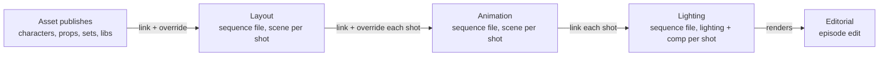

# blender-smallstudio-pipeline

Publishing, loading and scene construction for one person or a small team, entirely
inside Blender. Built for an animated comic series, with nothing studio-specific baked in.

> **Status: early.** Assets work end to end: create them, work on them, check and publish
> them, link them from the Asset Browser, and keep files up to date. Sequences have a
> layout file that creates shots and publishes their frame ranges, cut and casting.
> Animation and lighting come next (see [spikes](spikes/RESULTS.md) for the Blender
> behaviour they rely on). Not ready for production yet.

## What it does

- **Publishing.** Checks run first ([publish-validator](https://github.com/jmleventhorpe/publish-validator)),
  then only the asset's root collection and its dependencies are written: a versioned file
  plus a hero file that shots link, so they pick up the latest on open.
- **Loading.** Assets come in through Blender's Asset Browser, linked by default, with
  library overrides only where something must be editable.
- **Shots.** Layout creates shots from sequencer strips and decides casting. Animation,
  like layout, is one file per sequence with a scene per shot; it links each shot from the
  layout publish and overrides it, so layout's later changes keep coming through. Lighting
  files link the animation publishes, and the episode edit uses the best media available.
- **No database.** Each entity is a folder with a small metadata file; per-project
  settings live in a `pipeline.toml` at the project root.

Blender 5.3. Kitsu support is planned behind a tracker interface.

## How it fits together



## Using it in Blender

1. Install the extension zip (Preferences > Get Extensions > Install from Disk).
2. In the add-on's preferences, add your project folder: the one holding `pipeline.toml`.
   The list is kept for this machine in `~/.config/smallstudio-pipeline/projects.json`
   (`%APPDATA%\smallstudio-pipeline\` on Windows), so updating the add-on or Blender keeps
   it. Set `SMALLSTUDIO_PIPELINE_SETTINGS` to use another file.
3. Use the **Pipeline** menu in the top bar: Open…, New Workfile… (an empty file saved in
   the right place), Save To… (save the open file as any asset's, sequence's or shot's
   next workfile), New Node…, Version Up, Publish and Check Updates. Below those, only
   where they apply: Make Editable and Override (a linked asset selected), Back to Link
   (an overridden or made-editable one), and Add Shot and Omit Shot (a file with a cut). Next to it, the top bar shows what the open file is (`hero · rig · v012`, with
   `· shot 0015` or `· cut` in a file with a cut), in the warning colour for a publish, a
   file outside the pipeline, or one someone else has open.
4. Open the **Pipeline** tab in the sidebar (N) of the 3D viewport or the Video Sequencer.
   Its panels show what applies: **Context** (the file, what's on show, warnings),
   **Nodes** (the scene's nodes, New Node, and changing a node's task), **Shot** (the shot
   you're in: frames, cut, cast), **Publish**
   (the node, the version it becomes, Check, Link Back) and **Workfiles** (browse and
   open any task's workfiles).

**Nodes** say what a file is working on. A node is a collection carrying what it is: an
asset node its asset, type and task (model, rig); a sequence node its sequence, which
makes its scene the cut; a shot node its shot. New Node makes one, empty, in the open
file: an asset node goes inside the active collection, so a prop can be made inside its
set's node. A file can hold several nodes, even of one asset (its model and its rig).
Workfiles are just files saved in the right place: nothing is added to them.

**Publishing** works on the node you click in the Outliner (or else the one holding the
selection) and checks it first with
[publish-validator](https://github.com/jmleventhorpe/publish-validator). An asset node
publishes its asset as its task; a sequence's or any shot's node publishes the
sequence's layout, that shot first. The Publish panel shows the node and the version it
becomes straight away; Check adds the hero it replaces, or for a layout each shot and what
changed, and runs the checks without writing anything; any problems are listed there,
each with Select (and Fix where it can). A publish writes a new version and replaces the
hero file that other files link, marked for the Asset Browser with a thumbnail, in its
task's catalog (`character/model`, `character/rig`); its record
lists the instances placed in the node, so a set's publish says what's in it and where. A
rig takes its model's latest materials on every publish. Any linked asset, in any
file, can be made editable (a crate in its set, or a set in a shot), published from there
in its own space, and, with **Link Back** ticked, linked back in where it stood. Or it can
be overridden where it stands: a character posed, or a set's pieces moved for one shot
only, while updates to the set still arrive. Back to Link undoes either, throwing away
what was changed. Where to use which is the artist's call.

**Layout**: a sequence's node makes its scene the cut, with a strip per shot. Add Shot
puts a new shot after the one at the playhead, numbered between its neighbours (0015
between 0010 and 0020), with its own scene starting at frame 101, a shot node holding its
camera, and a timeline marker. With Follow the cut (Blender's Sync Scene Time, on in new
cuts) the 3D viewport shows the shot under the sequencer's playhead, so scrubbing the cut
shows each shot; Back to Cut returns to it. Assets dragged in from the Asset Browser get
an instance ID on save (`crate_01`); Override makes one posable where it stands, or
lets a set be dressed for that shot, and Back to Link undoes it. Publishing the layout
checks each shot, publishes the whole file, and writes each shot's frame range, cut
points and casting into its metadata; a shot whose strip is gone is marked omitted. The
cut renders its playblast to the sequence's layout render folder for the workfile's
version.

**Animation**: one file per sequence, like layout. In a new animation workfile, New Node
› Animation builds the cut from the layout publish: a strip per shot where layout put
it, and a scene per shot holding its animation node (`010_010_0010.anim`), with the
shot's node from the layout publish linked and overridden inside. The camera, cast and
dressed set are layout's, not copies, so a republished layout comes through on opening
for anything not changed here. Shots are added and omitted in layout; Check Updates
brings the animation cut in line (new shots get a scene, retimed ones their range and
place, omitted ones lose their strip but keep their scene). A character layout
left linked can be overridden here to animate it. What layout keyed (blocking, a camera
move) plays layout's keys; Animate gives the selection (a whole character) its own copy
to key on top, after which it no longer follows layout's keys. Publishing (from the
sequence's or any shot's animation node) checks each shot, warns where its cast differs
from layout's, and writes each shot's animation node into the sequence's animation
publish, for lighting to link.

A project can tune the checks with a `validation.toml` beside its `pipeline.toml`, and add
its own checks in a `checks/` folder there (see
[writing checks](https://github.com/jmleventhorpe/publish-validator/blob/main/docs/writing-checks.md)).

## Using the core

```python
from pathlib import Path
from smallstudio_pipeline.project.core.project import Project

project = Project.create(Path("/mnt/show"))
hero = project.create_asset("character", "hero")
hero.workfile_path("rig", hero.next_workfile_version("rig"))
# /mnt/show/assets/character/hero/rig/work/hero_rig_v001.blend

shot = project.create_sequence(episode="010").create_shot()
shot.render_path("light", 1)
# /mnt/show/shots/010_010_0010/light/render/v001
```

## Layout of the code

| Path | What's there |
| --- | --- |
| `src/smallstudio_pipeline/project/` | Settings, names and paths, assets, sequences and shots, nodes, this machine's project list. `defaults.toml` holds the built-in settings a project's `pipeline.toml` overrides. |
| `src/smallstudio_pipeline/workfiles/` | What a file is, new workfiles, Open and Version Up, in-use markers. |
| `src/smallstudio_pipeline/loading/` | Linking publishes, Check Updates, instances, Override, Make Editable and Back to Link. |
| `src/smallstudio_pipeline/publishing/` | Checks (with the pipeline's own in `checks/` and `validation.toml`), then writing asset and layout publishes. |
| `src/smallstudio_pipeline/shots/` | The sequence layout file: the cut, Add Shot and Omit Shot. |
| `src/smallstudio_pipeline/common/`, `session/`, `interface/` | Shared helpers; what's open and the load/save handlers; the Pipeline menu. |
| `src/smallstudio_pipeline/wheels/` | publish-validator, bundled as a wheel. |

In each job, `core/` holds the rules and never imports Blender (tested in plain Python),
and `blender/` does the work in Blender, with the job's menu actions in `operators.py`
(tested in headless Blender).
| `tests/core/`, `tests/blender/` | The two test suites. |
| `spikes/` | Scripts that tested the Blender behaviour the design relies on, with [results](spikes/RESULTS.md). |
| `scripts/build_extension.py` | Builds and validates the extension zip. |

[docs/architecture.md](docs/architecture.md) explains how the modules fit together, what a
publish does step by step, and where to add tasks, checks and menu actions.

## Development

Needs [uv](https://docs.astral.sh/uv/) and Blender 5.3 on the `PATH` (or in `$BLENDER`).

```bash
uv sync
```

```bash
uv run pytest
```

```bash
uv run ruff check && uv run ruff format --check && uv run pyright
```

Tests inside Blender use pytest and publish-validator installed next to the repo, since
Blender doesn't bundle them:

```bash
uv pip install --python 3.13 --target .blender-site pytest src/smallstudio_pipeline/wheels/*.whl
```

```bash
blender -b --factory-startup --python tests/blender/run.py
```

Build the extension zip into `dist/`:

```bash
uv run python scripts/build_extension.py
```

See [CONTRIBUTING.md](CONTRIBUTING.md) for code style.

## Licence

GPL-3.0-or-later, as required for Blender add-ons. See [LICENSE](LICENSE).
