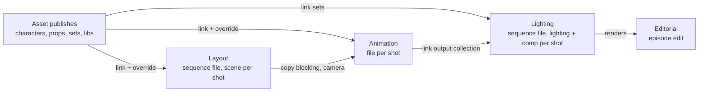

# blender-smallstudio-pipeline

Publishing, loading and scene construction for one person or a small team, entirely
inside Blender. Built for an animated comic series, with nothing studio-specific baked in.

> **Status: early.** Assets work end to end: create them, work on them, check and publish
> them, link them from the Asset Browser, and keep files up to date. Layout, shots,
> animation and lighting come next (see [spikes](spikes/RESULTS.md) for the Blender
> behaviour they rely on). Not ready for production yet.

## What it does

- **Publishing.** Checks run first ([publish-validator](https://github.com/jmleventhorpe/publish-validator)),
  then only the asset's root collection and its dependencies are written: a versioned file
  plus a hero file that shots link, so they pick up the latest on open.
- **Loading.** Assets come in through Blender's Asset Browser, linked by default, with
  library overrides only where something must be editable.
- **Shots.** Layout creates shots from sequencer strips and decides casting. Animation
  files are built from layout, lighting files from the animation publishes, and the
  episode edit from the best media available.
- **No database.** Each entity is a folder with a small metadata file; per-project
  settings live in a `pipeline.toml` at the project root.

Blender 5.2 LTS only. Kitsu support is planned behind a tracker interface.

## How it fits together



## Using it in Blender

1. Install the extension zip (Preferences > Get Extensions > Install from Disk).
2. In the add-on's preferences, add your project folder: the one holding `pipeline.toml`.
3. Use the **Pipeline** menu in the top bar: New Asset…, New Workfile…, Open…, Version Up,
   Publish and Check Updates (and Make Editable when a linked asset is selected). Next to
   it, the top bar shows what the open file is (`hero · rig · v012`), in the warning colour
   for a publish, a file outside the pipeline, one someone else has open, or one built
   from an older publish.

**Publishing** checks the asset first with
[publish-validator](https://github.com/jmleventhorpe/publish-validator); if anything
blocks it, the problems are listed under **Pipeline** in the 3D viewport's sidebar, each
with Select (and Fix where it can). A publish writes a new version and replaces the hero
file that other files link, marked for the Asset Browser with a thumbnail. Rigs start from
the latest model publish and take its materials again on every publish. An asset can also
be edited, or started, inside another asset's file (a prop inside its set) and published
from there.

A project can tune the checks with a `validation.toml` beside its `pipeline.toml`, and add
its own checks in a `checks/` folder there (see
[writing checks](https://github.com/jmleventhorpe/publish-validator/blob/main/docs/writing-checks.md)).

## Using the core

```python
from pathlib import Path
from smallstudio_pipeline.core.project import Project

project = Project.create(Path("/mnt/show"))
hero = project.create_asset("character", "hero")
hero.workfile_path("rig", hero.next_workfile_version("rig"))
# /mnt/show/assets/character/hero/rig/work/hero_rig_v001.blend

shot = project.create_sequence(episode="010").create_shot()
shot.render_path("light", 1)
# /mnt/show/shots/010_010_0010/light/render/v001
```

## Layout of the code

| Path | What's there |
| --- | --- |
| `src/smallstudio_pipeline/core/` | The rules, with no Blender imports: settings, names and paths, projects and entities, and what workfiles, publishes and updates are. Tested in plain Python. |
| `src/smallstudio_pipeline/defaults.toml` | Built-in settings: asset types, tasks, naming, path templates. A project's `pipeline.toml` overrides any of them. |
| `src/smallstudio_pipeline/blender/` | Doing it in Blender: workfiles, libraries, updates, validation, load/save handlers. Tested in headless Blender. |
| `src/smallstudio_pipeline/blender/assets/` | Asset work: publishing, rig materials, editing an asset inside a set. |
| `src/smallstudio_pipeline/blender/operators/` | The Pipeline menu's actions, one per file. |
| `src/smallstudio_pipeline/blender/ui/` | The menu and top bar, the results panel, preferences. |
| `src/smallstudio_pipeline/checks/`, `validation.toml` | The pipeline's own publish checks and its publish-validator settings. |
| `src/smallstudio_pipeline/wheels/` | publish-validator, bundled as a wheel. |
| `tests/core/`, `tests/blender/` | The two test suites. |
| `spikes/` | Scripts that tested the Blender behaviour the design relies on, with [results](spikes/RESULTS.md). |
| `scripts/build_extension.py` | Builds and validates the extension zip. |

[docs/architecture.md](docs/architecture.md) explains how the modules fit together, what a
publish does step by step, and where to add tasks, checks and menu actions.

## Development

Needs [uv](https://docs.astral.sh/uv/) and Blender 5.2 on the `PATH` (or in `$BLENDER`).

```bash
uv sync
```

```bash
uv run pytest
```

```bash
uv run ruff check && uv run ruff format --check && uv run pyright
```

Tests inside Blender use pytest and publish-validator installed next to the repo, since
Blender doesn't bundle them:

```bash
uv pip install --python 3.13 --target .blender-site pytest src/smallstudio_pipeline/wheels/*.whl
```

```bash
blender -b --factory-startup --python tests/blender/run.py
```

Build the extension zip into `dist/`:

```bash
uv run python scripts/build_extension.py
```

See [CONTRIBUTING.md](CONTRIBUTING.md) for code style.

## Licence

GPL-3.0-or-later, as required for Blender add-ons. See [LICENSE](LICENSE).
