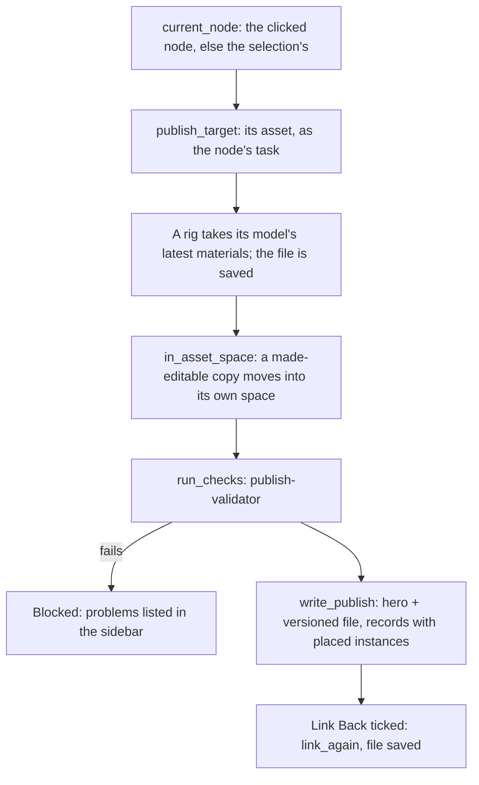

# Architecture

How the add-on's code is laid out, what happens when a file opens and when something is
published, and where to add things. Each module's docstring says more about it.

## Split by job

```
src/smallstudio_pipeline/
├── project/      settings, names and paths, assets, sequences and shots
├── workfiles/    what a file is, new workfiles, Open, Version Up
├── loading/      linking publishes, keeping them current, instances, editable copies
├── publishing/   checks, then writing publishes for other files to link
├── shots/        the sequence layout file and its cut
├── common/       small helpers every job uses
├── session/      what's open, and keeping every job in step as files open and save
└── interface/    the Pipeline menu, the dialogs' choices, what operators share
```

Every job has the same two folders:

- **`core/`** holds the job's rules. It never imports Blender, so it runs, and is tested,
  in plain Python in well under a second.
- **`blender/`** does the job in Blender, and holds the job's menu actions in
  `operators.py`.

`common/` never imports Blender either. A ruff rule (`TID251` in `pyproject.toml`) and a
test stop any `core/` or `common/` file from importing `bpy`, `bmesh` or `mathutils`.

Only operators read `bpy.context`. Everything else takes the scene, collection or
object it works on, so it runs headless in the tests.

## Module map

| Job | `core/` decides | `blender/` does |
| --- | --- | --- |
| **project** | `config` (defaults.toml merged with pipeline.toml), `naming`, `templates`, `metadata`, `tracker`, `project`, `entities`, `machine` (this machine's project list) | `identity` (the properties nodes carry), `nodes` (which collections are nodes, the node Publish works on), `preferences` (the project list page) |
| **workfiles** | `context` (what a file is, from its path), `workfiles` (next free version), `inuse` (who has a file open) | `workfiles` (saving in the right place), operators: Open, New Workfile, Save To, Version Up |
| **loading** | `updates` (what's out of date), `casting` (instance IDs) | `libraries` (linking, the Asset Browser library), `updates` (reloading), `instances` (what stands in a scene, Override), `editable` (Make Editable, linking a copy again), operators: Check Updates, Make Editable, Override, Back to Link |
| **publishing** | `publishing` (targets, plans, records with placed instances), `catalogs` | `assets` (writing asset publishes, thumbnails, placements), `layout` (Save Copy of a layout file), `in_context` (asset space, Link Back), `materials` (rig takes model's materials), `validation`, `review` (Check), `results`, `panels` (Publish), operators: Publish, Check |
| **shots** | `layout` (the cut into each shot's metadata) | `layout` (the cut, strips, markers, playblast path), `panels` (Shot), operators: Add Shot, Omit Shot, Back to Cut |

Outside the jobs: `common/` (`errors`, `files`, `reading`), `session/` (`state`,
`handlers`), `interface/` (`menu`, `panels`, `nodes` for New Node and the Nodes panel, `browse`, `common`), `publishing/checks/` and
`publishing/validation.toml` (the pipeline's own checks and settings), and `wheels/`
(publish-validator, bundled).

## The Pipeline tab

The sidebar of the 3D viewport and the Video Sequencer has a Pipeline tab. Each job draws
its own panel there, in this order: Context (`interface/panels.py`), Nodes
(`interface/nodes.py`), Shot (`shots/blender/panels.py`), Publish
(`publishing/blender/panels.py`) and Workfiles (`workfiles/blender/panels.py`).
`interface/panels.both_sidebars()` makes the two classes Blender needs (one per editor)
from one panel class. A panel hides when it doesn't apply to the open file.

Drawing never reads the disk, which may be a slow shared drive: Publish shows what
Check found (`publishing/blender/review.py`); Workfiles lists what was read when its
choices changed. The tests draw each panel into a stand-in layout, since Blender doesn't
draw headless.

## The node

Publishing works on a node (`project/blender/nodes.py`). An asset's node publishes that
asset; a layout file's sequence node and every shot's node publish the sequence's layout.
The node follows what you picked last: the collection you clicked in the Outliner, when
it's a node, or the node holding the selection; failing both, the scene's only one. A
loaded asset (linked, or overridden for posing) isn't a node, so picking one greys out
Publish. `session/handlers.py` notes which changed last (`note_picks`) when the scene updates
(selecting does) or the message bus says the clicked collection or the scene on show
changed, and only then redraws the Pipeline tab.

## Registering

Blender calls the package's `register()`. It asks each job to register in turn
(project, workfiles, loading, publishing, shots, interface, session) and the reverse to
unregister. Each job's `blender/__init__.py` registers its own classes, importing them
only when called, so a job's modules can import each other's without loops. `session`
goes last: it adds the load and save handlers and looks at the open file once Blender is
ready.

## When a file opens

1. `session.handlers` refreshes `session.state`: the project (from the file's path, or
   the active project in this machine's settings file), what the file is, and the top
   bar's label.
2. It marks the file as in use, or warns whose it is (workfiles).
3. It adds the project's `assets` folder to Blender's asset libraries and notes the
   version of every publish the file links (loading).
4. Files from before nodes carried everything get their scenes' identity moved onto
   nodes, and their asset nodes the workfile's task (project).
5. In a file with a cut, each workspace's Video Sequencer is pointed at it (shots).

Before a save, new instances get their IDs, and a cut's playblast output follows the
version being saved. After a save, including Version Up, the in-use marker
moves to the new file.

## Nodes

A node is one of the file's own collections carrying what it is (`project/blender/
identity.py`): an asset node its asset, type and task; a sequence node its sequence; a
shot node its shot. Scenes carry nothing: a cut is the scene holding a sequence's node, a
shot's scene the one holding its node. Workfiles are files saved in the right place (New
Workfile, Save To, Version Up); New Node makes nodes in whatever file is open. Everything
that acts on "what this is" reads nodes (`project/blender/nodes.py`), never the file's
path, which only names the file and drives Version Up.

## When an asset is published



`write_publish` (`publishing/blender/assets.py`) writes only the node's collection and
what it uses, never the artist's whole file. The hero file is overwritten each time and
marked as an asset that links; the versioned file is kept. Each gets a JSON record beside
it (source file, Blender version, objects, dependencies, the instances placed in the node
with their transforms, check results), which Check Updates reads.

## When a layout is published

1. `shots/blender/layout` makes each shot scene's range what its strip shows, so
   retiming in the cut counts.
2. The file is saved, which numbers any new instances (`crate_03`).
3. Each shot is checked on its own scene: a camera, unique instance IDs (with a Fix),
   and only this project's assets. The sidebar lists problems under each shot's code.
4. The versioned file and hero are Save Copies of the whole workfile
   (`publishing/blender/layout`), since `bpy.data.libraries.write` can't write scenes
   (spike T13).
5. `shots/core/layout.apply_cut` writes each shot's frame range, cut points and casting
   into its metadata, and marks shots with no strip omitted. The record lists the
   publishes the file links.

## Where to add things

- **A task or asset type:** settings only. Add it to `project/defaults.toml` (or a
  project's `pipeline.toml`) with its templates; `config` checks it on load.
- **A publish check:** a class in `publishing/checks/blender/pipeline.py` for every
  project, or in a project's own `checks/` folder for one. Derive it from `AssetCheck` or
  `ShotCheck` there to run it only on assets or only on each shot of a layout publish.
  Switch checks on and off, or make them warnings, in `validation.toml`. Check files
  can't import the add-on, so pipeline facts arrive in the subject's `extras` (see
  `publishing/blender/validation.py`).
- **A menu action:** an operator in its job's `blender/operators.py`, added to that
  file's `CLASSES` and to the menu in `interface/menu.py`. Put the rules in the job's
  `core/`, the Blender work in a module beside the operators, and keep the operator to
  gathering choices and reporting errors.
- **A new job** (animation in M5, say): a folder with `core/` and `blender/`, its
  `blender/__init__.py` registering its classes, and a line in the package's `_jobs()`.
- **A folder layout change:** edit the templates; paths always come from them.

## Tests

`tests/core` runs in plain Python. `tests/blender` runs inside headless Blender
(`tests/blender/run.py`) against temporary projects, with helpers in its `conftest.py`
for making, publishing and linking assets, and its own machine settings file. Spikes in
`spikes/` recorded the Blender behaviour the design relies on;
[RESULTS.md](../spikes/RESULTS.md) says what each found.
