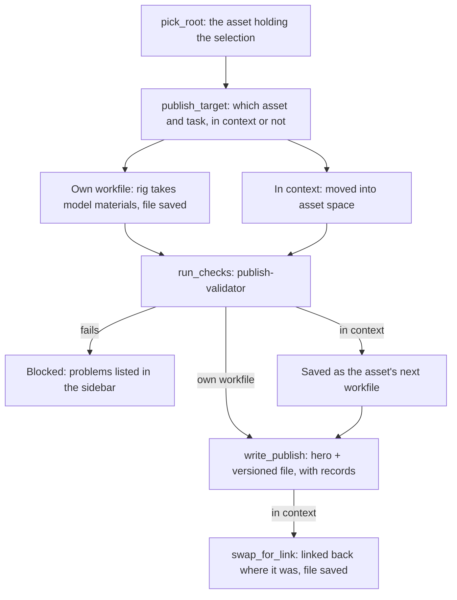

# Architecture

How the add-on's code is laid out, what happens when a file opens and when an asset is
published, and where to add things. Each module's docstring says more about it.

## Two layers

```
src/smallstudio_pipeline/
├── core/                 the rules; never imports Blender
└── blender/              doing it in Blender
    ├── assets/           asset work: publishing, rig materials, editing in context
    ├── shots/            shot work: the layout file, instances, the layout publish
    ├── operators/        the Pipeline menu's actions, one per file
    └── ui/               menu, top bar, results panel, preferences, dialog choices
```

Modules every stage uses sit at the top of `blender/`; work for one stage sits in that
stage's folder. `core` stays flat while it's small.

`core` decides; `blender` does. A topic usually has a module in each:

| Topic | `core/` decides | `blender/` does |
| --- | --- | --- |
| Workfiles | where the first workfile goes, what it starts from, the next free version | opens the starter, brings in what it builds on, saves |
| Publishing | what's being published, the next version, where files go, what's recorded | picks the root, writes only it and what it uses, marks the hero for the Asset Browser |
| Updates | which links were published again, which builds are out of date | reloads libraries, flags files |

Keeping the rules out of Blender means they run, and are tested, in plain Python in well
under a second. A ruff rule (`TID251` in `pyproject.toml`) and a test stop `core` from
importing `bpy`, `bmesh` or `mathutils`.

Inside `blender`, only operators read `bpy.context`. Everything else takes the collection
or object it works on, so it runs headless in the tests.

## Module map

**core**, from the bottom up:

| Module | What's there |
| --- | --- |
| `config` | Settings: `defaults.toml` merged with a project's `pipeline.toml`, checked on load. |
| `naming`, `templates` | The name rule, shot codes, and path templates that turn fields into paths and back. |
| `reading`, `files`, `metadata` | Typed reading of TOML and JSON, safe writes on shared storage, entity metadata files. |
| `errors` | `PipelineError` and its subclasses; their messages reach the artist as they are. |
| `tracker` | Where entity data comes from: the filesystem now, Kitsu later. |
| `project`, `entities` | A project and the assets, sequences and shots in it, and where each task's files go. |
| `context` | What a file is, from its path: entity, task, version, workfile or publish. |
| `workfiles`, `publishing`, `updates` | The rules for each topic above. |
| `layout`, `casting` | What a layout publish writes into each shot (range, cut, casting); instance IDs. |
| `catalogs`, `inuse` | Asset Browser catalogs; markers saying who has a file open. |

**blender**:

| Module | What's there |
| --- | --- |
| `state` | What the open file is, worked out on load and save so the UI can read it cheaply. |
| `handlers` | Load and save handlers: refresh state, in-use markers, asset library, versions seen. |
| `identity` | The custom properties on an asset's root collection: name, type, instance id, built from. |
| `workfiles`, `updates` | Each topic's Blender side. |
| `libraries` | Linking and appending from publishes; the project's asset library. |
| `validation` | Setting up publish-validator with the pipeline's checks and the project's. |
| `assets/publishing` | Picking the root and writing an asset's hero and versioned files. |
| `assets/materials` | A rig taking its model's materials on each publish. |
| `assets/in_context` | Editing and publishing an asset inside another asset's file. |
| `shots/layout` | The sequence layout file: master scene, cut, Add Shot and Omit Shot, playblast path. |
| `shots/instances` | Asset instances in a shot, their IDs, casting, and Override for Posing. |
| `shots/publishing` | The layout publish: per-shot check subjects, Save Copy of the whole file. |
| `operators/` | One per menu action: Open, New Workfile, New Asset, New Sequence, Version Up, Publish, Check Updates, Make Editable, Override for Posing, Add Shot, Omit Shot. |
| `ui/` | The Pipeline menu and top bar, the results panel, preferences, Open and New Workfile choices. |

Outside the two layers: `defaults.toml` (built-in settings), `validation.toml` and
`checks/` (the pipeline's publish checks), and `wheels/` (publish-validator, bundled).

## When a file opens

1. `handlers` refreshes `state.current`: the project (from the file's path, or the active
   project in the preferences), what the file is, and the top bar's label.
2. It marks the file as in use, or warns whose it is.
3. It adds the project's `assets` folder to Blender's asset libraries.
4. `updates` notes the version of every publish the file links, for Check Updates later,
   and flags any root built from an older publish (a rig from an old model).

On save, including Version Up, the in-use marker moves to the new file.

## When an asset is published



`write_publish` writes only the root collection and what it uses, never the artist's
whole file. The hero file is overwritten each time and marked as an asset that links; the
versioned file is kept. Each gets a JSON record beside it (source workfile, Blender
version, objects, dependencies, check results), which is what Check Updates and the stale
warnings read.

In context, writing the asset's workfile happens in a separate headless Blender, because
`bpy.data.libraries.write` crashes on scenes in Blender 5.2.2.

## When a layout is published

1. `shots/layout` makes each shot scene's range what its strip shows, so retiming in the
   cut counts.
2. The file is saved, which numbers any new instances (`crate_03`).
3. Each shot is checked on its own scene: a camera, unique instance IDs (with a Fix),
   and only this project's assets. The sidebar lists problems under each shot's code.
4. The versioned file and hero are Save Copies of the whole workfile, since
   `bpy.data.libraries.write` can't write scenes (spike T13).
5. `core/layout.apply_cut` writes each shot's frame range, cut points and casting into
   its metadata, and marks shots with no strip omitted. The record lists the publishes
   the file links.

## Where to add things

- **A task or asset type:** settings only. Add it to `defaults.toml` (or a project's
  `pipeline.toml`) with its templates; `config` checks it on load.
- **A publish check:** a class in `checks/blender/pipeline.py` for every project, or in
  a project's own `checks/` folder for one. Derive it from `AssetCheck` or `ShotCheck`
  there to run it only on assets or only on each shot of a layout publish. Switch checks on and off, or make them
  warnings, in `validation.toml`. Check files can't import the add-on, so pipeline facts
  arrive in the subject's `extras` (see `blender/validation.py`).
- **A menu action:** a file in `blender/operators/` with one operator, added to `CLASSES`
  in `operators/__init__.py` and to the menu in `ui/menu.py`. Put the rules in `core`,
  the Blender work in a `blender/` module, and keep the operator to gathering choices
  and reporting errors.
- **A folder layout change:** edit the templates; paths always come from them.

## Tests

`tests/core` runs in plain Python. `tests/blender` runs inside headless Blender
(`tests/blender/run.py`) against temporary projects, with helpers in its `conftest.py`
for making, publishing and linking assets. Spikes in `spikes/` recorded the Blender
behaviour the design relies on; [RESULTS.md](../spikes/RESULTS.md) says what each found.
